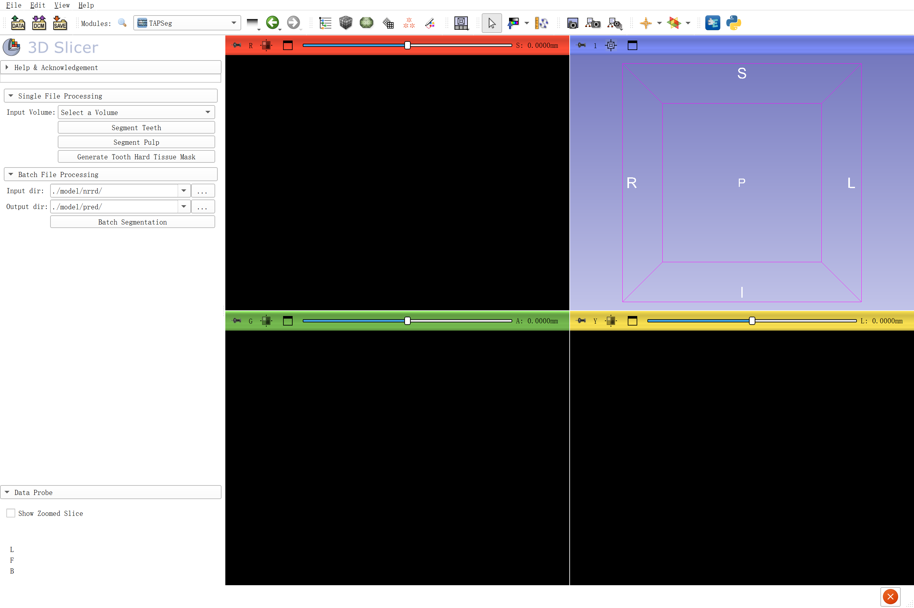

# TAPSeg

TAPSeg segments teeth and pulp from CBCT volumes in 3D Slicer and generates tooth hard-tissue masks by subtracting pulp from teeth.

## Installation

1. Download [TAPSeg.7z](https://github.com/simzhangbest/TAPSeg/releases/download/v0.1.0/TAPSeg.7z) and extract it.
2. In Slicer, open **Edit > Application Settings > Modules** and add the extracted `TAPSeg_refe/TAPSeg` directory to **Additional module paths**.
3. Restart Slicer and select **Segmentation > TAPSeg**.

Python dependencies are listed in `requirements.txt` and must be installed in Slicer's Python environment.

## Usage

1. Load a CBCT volume and select it as the input.
2. Select **Segment Teeth**.
3. Select **Segment Pulp**.
4. Select **Generate Tooth Hard Tissue Mask**.

**Batch Segmentation** processes supported volumes in a selected directory. Export the resulting segmentation nodes with Slicer's save dialog.

## Tutorial

[Video tutorial](https://www.bilibili.com/video/BV1SCPyziEcG/)

## Publication

[TAPSeg: An open-source deep learning tool for instance-level tooth and pulp segmentation in CBCT](https://doi.org/10.1016/j.jdent.2026.106643). Journal of Dentistry, 171 (2026), 106643.

Runtime checks do not establish clinical suitability. Review all automatically generated segmentations.

## License

Copyright (c) 2026 Y Zhang.

TAPSeg-specific source code and model weights are licensed under [Apache-2.0](LICENSE.txt). Commercial use, modification, and redistribution are permitted subject to the license terms. Third-party components retain their original licenses.
